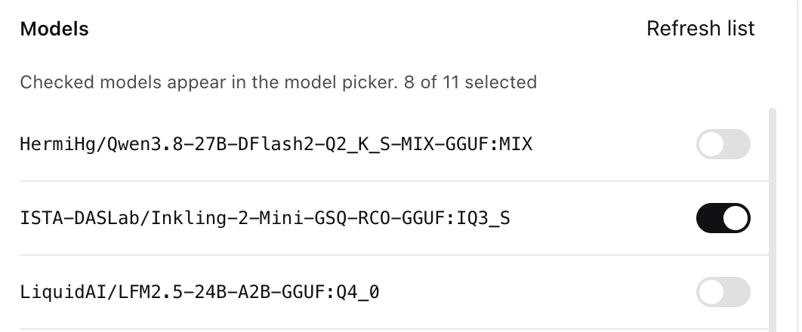

# Llama.cpp Provider for DeepSeek Harness

English | [中文](README.zh-CN.md)

## The models on your computer. Right inside DeepSeek Harness.

llama.cpp makes local models feel like any other model in DSH. It starts when DSH opens and quits when DSH does. Pick a model and it loads on its own. Your conversations stay on this computer, and no API key is needed.

## Before you begin

Install llama.cpp.

- **macOS**: Open Terminal and run
  `curl -LsSf https://llama.app/install.sh | sh`
- **Windows**: Open PowerShell and run
  `irm https://llama.app/install.ps1 | iex`

When it's done, reopen DSH.

## Install the plugin

In DSH, go to Plugins, click Add plugin, and install the npm package `dsh-llama-cpp-provider`.

## Start chatting

There's nothing to set up. Once the plugin is installed, **llama.cpp** appears in Settings > Models and in the model picker of every session, with every model llama.cpp offers. Choose one and start chatting.

Remove the plugin and llama.cpp disappears from Settings > Models and the model picker.

## Choose which models appear

In Settings > Models, click **Edit** next to llama.cpp. Each model has a switch. Turn off the ones you don't want in the model picker. Changes apply right away, so there's nothing to save.

Added or removed models in llama.cpp? Click **Refresh list**.

The same page also shows where llama.cpp was found. If it isn't installed yet, it shows how to install it.

A model you turn off is remembered by its name. If a model's name changes, for example after you rename its section in `models.user.ini`, it shows up again and you need to turn it off again.

## Tips

- **Tune a model**: Edit llama.cpp's `models.user.ini` file. llama.cpp picks up the change on its own.
- **A model downloads again, or loads the wrong file**: A name like `org/repo:Q4_0` can match more than one file in a Hugging Face repository, and llama.cpp checks online to pick one. To fix this, point the model at a file by adding `model = /full/path/to/file.gguf` to its section in `models.user.ini`. Or add `offline = true` under `[*]` so llama.cpp never goes online. Remove that line again when you want to download a new model.
- **Use a different llama.cpp**: The plugin finds the llama.cpp installed on your computer. To use another one, click Customize… on the plugin's detail page and choose its folder. You can also set the `DSH_LLAMA_CPP_PATH` environment variable to the `llama-server` (or `llama`) executable, or to its folder; the plugin also looks in `build/bin` and `bin` inside it. On macOS, apps opened from the Dock don't read `~/.zshrc` or `~/.zprofile`, so run `launchctl setenv DSH_LLAMA_CPP_PATH /full/path`, then quit and reopen DSH. The detail page shows which file is in use.
- **Keep models in another folder**: Set the `LLAMA_ARG_MODELS_DIR` environment variable to that folder, then reopen DSH. Its models show up alongside the ones you've downloaded.
- **Use a different preset file**: Set the `LLAMA_ARG_MODELS_PRESET` environment variable to its full path, then reopen DSH. llama.cpp uses it instead of `models.user.ini`.
- **llama.cpp doesn't appear after you install the plugin**: Reopen DSH.

## License

[MIT](LICENSE)
