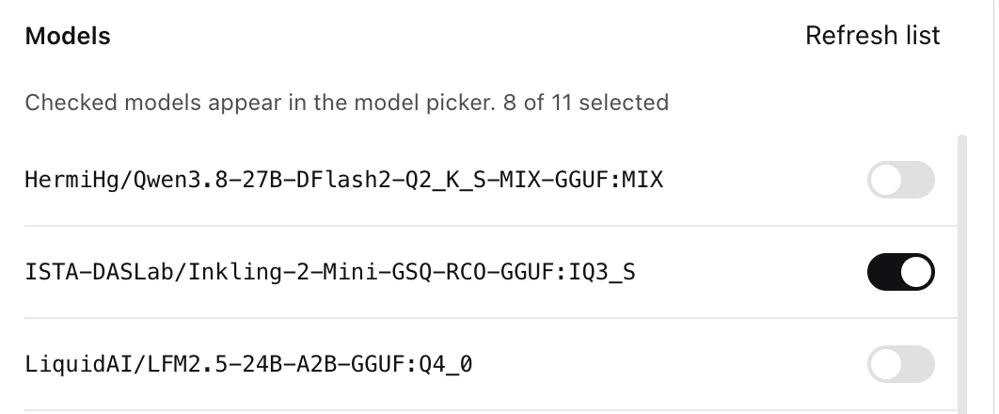

# DeepSeek Harness 的 llama.cpp Provider

[English](README.md) | 中文

## 你电脑上的模型，直接在 DeepSeek Harness 里用。

有了 llama.cpp，本地模型用起来和 DSH 里的其他模型一样。打开 DSH 时它会自动启动，退出 DSH 时一起关闭。选好模型就会自动加载。对话只留在这台电脑上，也不需要 API 密钥。

## 开始之前

先安装 llama.cpp。

- **macOS**：打开「终端」，运行
  `curl -LsSf https://llama.app/install.sh | sh`
- **Windows**：打开 PowerShell，运行
  `irm https://llama.app/install.ps1 | iex`

装好后，重新打开 DSH。

## 安装插件

在 DSH 里打开「插件」，点「添加插件」，安装 npm 包 `dsh-llama-cpp-provider`。

## 开始对话

不用再做别的设置。装好插件后，「设置」>「模型」和每个会话的模型选择器里都会出现 **llama.cpp**，llama.cpp 提供的模型都会列出来。选一个就能开始对话。

卸载插件后，llama.cpp 会从「设置」>「模型」和模型选择器里消失。

## 选择要显示的模型

在「设置」>「模型」里，点 llama.cpp 旁边的「编辑」。每个模型都有一个开关，关掉的模型就不会出现在模型选择器里。改动立即生效，不用保存。

在 llama.cpp 里增加或删除了模型？点「刷新列表」。

同一个页面还会显示 llama.cpp 是在哪里找到的。如果还没安装，会告诉你怎么装。

关掉的模型是按名称记住的。如果模型名称变了，比如你改了它在 `models.user.ini` 里的节名，它会重新出现，需要再关一次。

## 小贴士

- **调整模型参数**：编辑 llama.cpp 的 `models.user.ini`，改完会自动生效。
- **换用其他 llama.cpp**：插件会自动找到电脑上已安装的 llama.cpp。要换用别的，在插件详情页点「自定义…」，选择它所在的文件夹。也可以把环境变量 `DSH_LLAMA_CPP_PATH` 设为 `llama-server`（或 `llama`）可执行文件，或它所在的文件夹；插件还会在这个文件夹下的 `build/bin` 和 `bin` 里查找。在 macOS 上，从程序坞打开的应用不会读取 `~/.zshrc` 或 `~/.zprofile`，所以要运行 `launchctl setenv DSH_LLAMA_CPP_PATH /完整路径`，然后退出并重新打开 DSH。详情页会显示正在使用哪个文件。
- **模型放在别的文件夹**：把环境变量 `LLAMA_ARG_MODELS_DIR` 设为那个文件夹，然后重新打开 DSH。里面的模型会和你下载的模型一起显示。
- **换用别的预设文件**：把环境变量 `LLAMA_ARG_MODELS_PRESET` 设为它的完整路径，然后重新打开 DSH。llama.cpp 会用它代替 `models.user.ini`。
- **装好插件后看不到 llama.cpp**：重新打开 DSH。

## 许可

[MIT](LICENSE)
