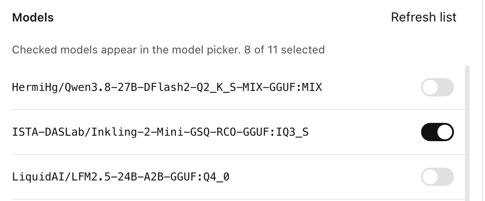

## The models on your computer. Right inside DeepSeek Harness.

Llama.cpp makes local models feel like any other model in DSH. It's ready the moment DSH opens, and it quits when DSH does. Pick a model and it loads automatically; switch to another and the last one is unloaded to free up memory. No models to manage by hand. No internet. No keys. Your conversations stay on this computer.

## Before you begin

Install llama.cpp.

- **macOS**: Open Terminal and run
  `curl -LsSf https://llama.app/install.sh | sh`
- **Windows**: Open PowerShell and run
  `irm https://llama.app/install.ps1 | iex`

When it's done, reopen DSH.

## Add Llama.cpp

1. Go to Settings > Models, then click Add model provider.
2. Under Third-party model provider, choose **Llama.cpp**.
3. Click Fetch available models, then click Save.

That's it. Choose a model under Llama.cpp in any session and start chatting.

## Tips

- When you add or edit Llama.cpp, its card shows whether llama.cpp is ready. If it isn't installed yet, the card tells you what to do.
- Want to tune a model? Edit llama.cpp's `models.user.ini` file, and Llama.cpp picks it up automatically.
- Don't see Llama.cpp under Third-party model provider after installing the plugin? Reopen DSH.
- Want a green dot next to Llama.cpp? Enter any API key on its card. Local models don't need one, so Llama.cpp works either way.
