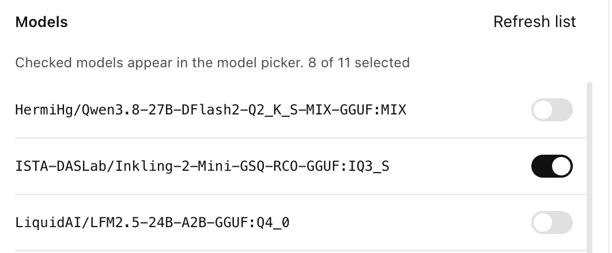

## 在 DSH 里，直接用你电脑上的模型。

Llama.cpp 让本地模型像其他模型一样，在 DSH 中随选随用。打开 DSH，它就已经就绪；关掉 DSH，它也随之退出。无需联网，无需密钥，你的对话只留在这台电脑上。

## 开始之前

先安装 llama.cpp。

- **macOS**：打开「终端」，运行
  `curl -LsSf https://llama.app/install.sh | sh`
- **Windows**：打开 PowerShell，运行
  `irm https://llama.app/install.ps1 | iex`

安装完成后，重新打开 DSH。

## 添加 Llama.cpp

1. 前往「设置」>「模型」，点按「添加模型供应商」。
2. 在「第三方模型供应商」中选择 **Llama.cpp**。
3. 点按「获取可用模型」，然后点按「保存」。

就这么简单。现在，在任意会话的模型列表里选择 Llama.cpp 下的模型，即可开始对话。

## 小提示

- 添加或编辑 Llama.cpp 时，卡片上会告诉你 llama.cpp 是否已就绪。如果还没安装，这里也会告诉你该怎么做。
- 想调整模型参数？编辑 llama.cpp 的 `models.user.ini` 文件即可，Llama.cpp 会自动读取。
- 安装插件后，如果在「第三方模型供应商」里找不到 Llama.cpp，请重新打开 DSH。
